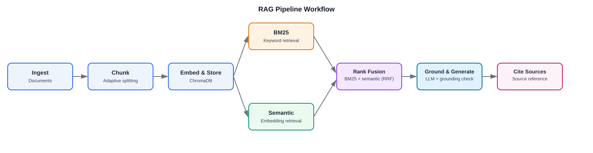

# Personal Document Assistant (RAG)

Upload your own documents and ask questions in plain language. You get a direct answer with the exact source cited.

**Live demo (invite only):** https://rag-personal-document-assistant.oooi0001.workers.dev

The demo opens only from an invitation link, which I share on request. See [Deployment](#deployment) for how it is hosted.

## Features

- **Multi-format ingestion:** PDFs, text files, and scanned reports (OCR is used only when a page has no selectable text)
- **Adaptive chunking:** chunk size and overlap change with the document type
- **Hybrid retrieval:** BM25 (keywords) plus semantic search (embeddings), merged by reciprocal rank fusion
- **Cross-document Q&A:** upload many files at once, and optionally limit a question to chosen files
- **Grounding check:** an LLM fact-checks each answer against the retrieved chunks
- **Source citation:** every `[Source N]` in an answer links to the file, page and chunk it came from
- **Chat sessions:** conversations are saved and can be resumed, and follow-up questions are rewritten to stand alone (only when they need it)
- **Streamed answers:** the answer text appears as it is written
- **Invitation links:** optionally make the app invite only, so only people with the link can open it
- **Evaluation and monitoring:** Recall@K and MRR for BM25, semantic and hybrid search, an LLM-judged answer score, a held-out question set, a grounding-check test, and per-request latency and token logging

## Tech stack

| Part | Tool | Model or note |
|---|---|---|
| Pipeline | LangChain | |
| Vector store | ChromaDB | cosine similarity |
| Keyword search | BM25 (`rank_bm25`) | |
| Embeddings | Voyage AI | `voyage-4` (switched from Qwen `qwen3.7-text-embedding` when its free quota ran out) |
| LLM | Qwen via DashScope | `qwen3.8-flash` |
| OCR | Tesseract | used only for pages with no text |
| Backend | FastAPI | |
| Frontend | React, Tailwind CSS, Vite | |
| Deployment | Cloudflare (frontend), AWS EC2 with Docker (backend), ngrok tunnel | deployed by GitHub Actions |

## Workflow



1. **Ingest:** load and read the uploaded files
2. **Chunk:** split pages into smaller pieces
3. **Embed and store:** turn chunks into vectors and save them in ChromaDB
4. **Retrieve:** run BM25 and semantic search on the question
5. **Rank:** merge the two lists by rank (reciprocal rank fusion) and keep the top chunks
6. **Generate and ground:** the LLM answers from the chunks, then the answer is fact-checked
7. **Cite:** return the answer with its sources

## Project structure

```
├── backend/            # fastapi app: main.py + routers (documents, sessions, chat)
├── frontend/           # react app: App.jsx, api.js, components (Document, Session, Chat panels)
├── src/                # the rag pipeline
│   ├── ingestion/      # pdf, text and ocr loaders, text cleaner, batch loader, sample docs
│   ├── chunking/
│   ├── embeddings/
│   ├── vectorstore/    # chromadb helpers and seeding
│   ├── retrieval/      # bm25, semantic, hybrid ranker, cross-document search
│   ├── generation/     # llm client, prompts, query rewriter, grounding check, generator
│   ├── citation/
│   ├── metrics/        # times each step and counts tokens, logged to data/metrics.jsonl
│   └── session/        # saves chats as json files
├── data/
│   ├── sample_docs/    # 3 sample files
│   ├── seed_chroma_db/ # prebuilt db with only the sample docs, copied on first start
│   ├── chroma_db/      # live db (created at runtime)
│   ├── uploads/        # uploaded files
│   └── sessions/       # saved chats
├── evaluation/         # labeled qa set, evaluation scripts, results
├── testing/            # phase test scripts, build_seed_db.py, ingest_sample_docs.py
├── tests/              # unit tests that need no api keys (run in ci)
├── .github/workflows/  # ci.yml: build, test, publish the image, deploy
├── Dockerfile          # backend image (python, tesseract, dependencies)
├── docker-compose.yml  # runs the backend locally and mounts data/
├── docker-compose.prod.yml  # runs the backend and ngrok on the server
├── requirements.txt
└── requirements-dev.txt     # test tools (pytest), used by ci
```

## Setup

You need a DashScope API key (chat model) and a Voyage AI API key (embeddings). Clone the repo, then create a `.env` file in the project root:

```
DASHSCOPE_API_KEY=your-key-here
DASHSCOPE_OPENAI_BASE_URL=https://dashscope-intl.aliyuncs.com/compatible-mode/v1
VOYAGE_API_KEY=your-key-here
INVITE_CODE=
CORS_ORIGINS=
```

| Variable | Purpose |
|---|---|
| `DASHSCOPE_API_KEY` | your DashScope key (required) |
| `DASHSCOPE_OPENAI_BASE_URL` | endpoint for the language model |
| `VOYAGE_API_KEY` | your Voyage AI key, for embeddings (required). Without a payment method Voyage allows about 3 requests a minute, so big uploads are slow |
| `INVITE_CODE` | optional. Leave empty to let anyone open the app. When set, only the invitation link works. Use a long random string |
| `CORS_ORIGINS` | optional, the frontend addresses allowed to call the api, separated by commas. Leave empty to allow any |

### Run the backend

Choose one.

**Docker** (no Python or Tesseract install needed). Install Docker Desktop, then from the project root:

```bash
docker compose up --build   # first run, or after code changes
docker compose up           # later runs
```

It reads `.env`, serves the api on `http://localhost:8000`, and keeps uploads, chats and the vector database in `data/` on your computer.

**Conda** (needs Python 3.11, and Tesseract for scanned PDFs, either on PATH or at the default Windows install path):

```bash
conda create -n rag-env python=3.11
conda activate rag-env
pip install -r requirements.txt
uvicorn backend.main:app --reload --port 8000
```

### Run the frontend

```bash
cd frontend
npm install
npm run dev     # open http://localhost:5173
```

On first start, the backend copies `data/seed_chroma_db` into `data/chroma_db`, so the sample docs are ready to query. If you change the sample docs, run `python testing/build_seed_db.py` and commit the new folder.

## Deployment

The frontend and backend are hosted separately, and GitHub Actions deploys the backend.

| Part | Where | How |
|---|---|---|
| Frontend | Cloudflare (static assets) | built from `frontend/` with `npm run build`, config in `frontend/wrangler.jsonc` |
| Backend | AWS EC2 server (Ubuntu, x86), in Docker | `docker-compose.prod.yml` pulls the image from GitHub Container Registry. `data/` stays on the server |
| Tunnel | ngrok static domain, a second container on the server | gives the backend a public https address |
| Pipeline | GitHub Actions | `.github/workflows/ci.yml` |

### CI/CD pipeline

| Job | What it does | Runs on |
|---|---|---|
| `frontend` | installs packages and builds the frontend | pull requests and `main` |
| `backend` | builds the image, runs the unit tests inside it, then smoke tests the container | pull requests and `main` |
| `publish` | pushes the image to `ghcr.io/<owner>/querio-backend` (tags `latest` and the commit sha) | `main`, after both jobs above pass |
| `deploy` | connects to the server over SSH, runs `git pull`, pulls the new image, restarts the containers and waits for the health check. Then it calls `/health` through the public address. The job fails if either check fails | `main`, after `publish` |

The unit tests live in `tests/` and need no api keys. Run them locally with `python -m pytest tests -q`.

### One-time server setup

Do this once, after creating the EC2 instance (Ubuntu, x86, 2 GB of memory or more, 20 GB disk):

1. Install Docker, then clone the repo to `~/querio`. The clone also brings the seed database in `data/seed_chroma_db`.
2. Run `docker login ghcr.io` on the server with a GitHub token that has only `read:packages`. The image is private.
3. Create `~/querio/.env` with the variables from [Setup](#setup) and `NGROK_AUTHTOKEN` (from the ngrok dashboard).
4. Allow SSH (port 22) in the security group from GitHub's runners. Their addresses change, so this means any address, and the key file is the protection.
5. Add three GitHub repository secrets:

| Secret | Value |
|---|---|
| `EC2_HOST` | the server's public address |
| `EC2_USER` | `ubuntu` |
| `EC2_SSH_KEY` | the full contents of the private key file |

After that, every push to `main` that passes the checks deploys itself.

### Settings that connect the parts

| Setting | Where | Value |
|---|---|---|
| `VITE_API_BASE_URL` | Cloudflare build variable | the tunnel address, ending in `/api` |
| `CORS_ORIGINS` | `.env` on the server | the Cloudflare site address |
| `INVITE_CODE` | `.env` on the server | the code inside the invitation link `https://<frontend>/?invite=<INVITE_CODE>` |
| `NGROK_AUTHTOKEN` | `.env` on the server | your ngrok token |

Notes:
- The frontend sends an `ngrok-skip-browser-warning` header, because ngrok's free warning page would otherwise block api calls.
- Uploads and chats persist across restarts and deploys, because `data/` is mounted from the server's disk.
- A static ngrok domain allows one tunnel at a time. To run the backend on your own computer instead, stop the server's containers first.
- The server's public address changes when the instance is stopped and started, unless an Elastic IP is attached. If it changes, update `EC2_HOST`.

Invitation links:
- Share `https://<frontend>/?invite=<INVITE_CODE>`. There is no login form, so the app cannot be opened without the link
- The browser saves the code and removes it from the address bar, so later visits work without the link
- To cut off everyone who has the old link, change `INVITE_CODE` and restart the backend, then share the new link
- Make a long random code with `python -c "import secrets; print(secrets.token_urlsafe(32))"`

## Usage

1. Upload one or more documents (PDF or text)
2. Optionally tick files to limit the search to them
3. Ask a question, or start from a suggestion
4. Read the answer, check the grounding badge, and click a `[Source N]` badge to see where it came from

## Performance

Measured on the earlier Render deployment with one document (details, method and per-question tables: [latency_report.md](evaluation/results/latency_report.md)):

| | Original (3 questions) | Now (15 questions) |
|---|---|---|
| Complete answer, median | 17.9 s | 5.9 s |
| Grounding check (runs after the answer is sent), median | 146.9 s | 4.0 s |
| Chat tokens per question (answer + grounding) | about 8,600 | about 1,530 |
| Rerank tokens per search | about 2,300 | 0 (reranker removed) |

A plain question was already about 5.5 s and is about 5.7 s now. The gains come from questions that used to trigger a slow follow-up rewrite, the grounding check, and tokens. The levers were capping the model's thinking budget, rewriting only follow-ups and removing the reranker. The original run is only 3 questions, so read the figures as approximate.

## Evaluation

87 labeled questions over 9 documents, each with an exact quote marking where its answer lives. It runs on a separate database, so your own data is never touched.

These numbers were measured with the earlier Qwen embeddings and have not been re-run with Voyage.

| Search (top 5, Qwen embeddings) | Recall@5 | MRR@5 |
|---|---|---|
| BM25 | 0.920 | 0.838 |
| Semantic | 0.931 | 0.823 |
| **Rank fusion of both (the app)** | **0.966** | **0.883** |

- **Answers:** an LLM judge graded 30 answers as 28 correct, 2 partial, 0 wrong.
- **Biggest win:** the BM25 tokenizer fix (strip punctuation, drop stop words) took BM25 recall from 0.77 to 0.92.
- **No reranker:** a Qwen reranker was tried and removed. It cost about 7,400 tokens per search, and rank fusion alone was nearly as good.
- **Held-out test:** on 19 harder questions written after tuning (paraphrased, cross-document, unanswerable), recall was about 0.82 (wide margin of error), and all 5 unanswerable questions were declined correctly.
- **Grounding check:** it caught 92% to 96% of deliberately damaged answers, with no false alarms.

The development questions share wording with their sources, so treat 0.966 as the optimistic figure. Full results, confidence intervals and limitations: [evaluation_report.md](evaluation/results/evaluation_report.md).

```bash
python evaluation/download_eval_docs.py       # fetch the 6 arXiv papers
python evaluation/build_eval_db.py            # build the separate eval database
python evaluation/evaluation.py --answers 30  # retrieval metrics and graded answers
python evaluation/ablation.py                 # search methods and chunk size comparison
python evaluation/tuning.py                   # BM25 tokenizer and fusion experiments
python evaluation/final_comparison.py         # original vs tuned, on dev and held-out questions
python evaluation/grounding_eval.py 30        # how well the grounding check catches damaged answers
```

Token cost: the answer-grading scripts (`evaluation.py`, `final_comparison.py`, `grounding_eval.py`) use the chat model, roughly 60k to 330k tokens each. The others only embed the questions (a few thousand tokens). `evaluation/embedding_comparison.py` compares the api embedding model (now Voyage) with a local one.

## Future improvements

- Benchmark latency on larger document sets and other document types (so far it is one document), and measure cost in money as well as tokens
- Attach an Elastic IP to the server, so its address does not change when the instance restarts
- Restrict SSH to fewer addresses, for example by deploying through a self-hosted runner or a VPN, instead of leaving port 22 open to every address

## Author

Pei Shuen · [GitHub](https://github.com/peishuen)
