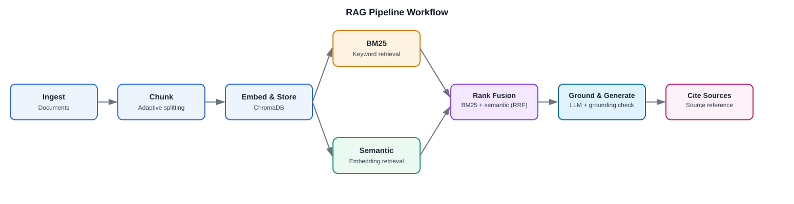

# Personal Document Assistant (RAG)

Upload your own documents and ask questions in plain language. You get a direct answer with the exact source cited.

**Live demo:** private (React frontend on Cloudflare, FastAPI backend on my own machine behind an ngrok tunnel). Ask me for an access link.
**Original Streamlit version:** [streamlit.app](https://peishuen-rag-personal-document-assistant-app-h78qzs.streamlit.app/)

## Features

- **Multi-format ingestion:** PDFs, text files, and scanned reports (OCR is used only when a page has no selectable text)
- **Adaptive chunking:** chunk size and overlap change with the document type
- **Hybrid retrieval:** BM25 (keywords) plus semantic search (embeddings), merged by reciprocal rank fusion
- **Cross-document Q&A:** upload many files at once, and optionally limit a question to chosen files
- **Grounding check:** an LLM fact-checks each answer against the retrieved chunks
- **Source citation:** every `[Source N]` in an answer links to the file, page and chunk it came from
- **Chat sessions:** conversations are saved and can be resumed, and follow-up questions are rewritten to stand alone (only when they need it)
- **Streamed answers:** the answer text appears as it is written
- **Optional access key:** protect the API with a token, or sign in with a magic link
- **Evaluation and monitoring:** Recall@K and MRR for BM25, semantic and hybrid search, an LLM-judged answer score, a held-out question set, a grounding-check test, and per-request latency and token logging

## Tech stack

| Part | Tool | Model or note |
|---|---|---|
| Pipeline | LangChain | |
| Vector store | ChromaDB | cosine similarity |
| Keyword search | BM25 (`rank_bm25`) | |
| Embeddings | Qwen via Alibaba DashScope | `qwen3.7-text-embedding` |
| LLM | Qwen via DashScope | `qwen3.8-flash` |
| OCR | Tesseract | used only for pages with no text |
| Backend | FastAPI | |
| Frontend | React, Tailwind CSS, Vite | |
| Deployment | Cloudflare (frontend), ngrok tunnel to a local FastAPI backend | |
| Original UI | Streamlit (`app.py`) | |

## Workflow



1. **Ingest:** load and read the uploaded files
2. **Chunk:** split pages into smaller pieces
3. **Embed and store:** turn chunks into vectors and save them in ChromaDB
4. **Retrieve:** run BM25 and semantic search on the question
5. **Rank:** merge the two lists by rank (reciprocal rank fusion) and keep the top chunks
6. **Generate and ground:** the LLM answers from the chunks, then the answer is fact-checked
7. **Cite:** return the answer with its sources

## Project structure

```
├── backend/            # fastapi app: main.py + routers (documents, sessions, chat)
├── frontend/           # react app: App.jsx, api.js, components (Document, Session, Chat panels)
├── src/                # the rag pipeline
│   ├── ingestion/      # pdf, text and ocr loaders, text cleaner, batch loader, sample docs
│   ├── chunking/
│   ├── embeddings/
│   ├── vectorstore/    # chromadb helpers and seeding
│   ├── retrieval/      # bm25, semantic, hybrid ranker, cross-document search
│   ├── generation/     # llm client, prompts, query rewriter, grounding check, generator
│   ├── citation/
│   ├── metrics/        # times each step and counts tokens, logged to data/metrics.jsonl
│   └── session/        # saves chats as json files
├── data/
│   ├── sample_docs/    # 3 sample files
│   ├── seed_chroma_db/ # prebuilt db with only the sample docs (shipped in the image)
│   ├── chroma_db/      # live db (created at runtime)
│   ├── uploads/        # uploaded files
│   └── sessions/       # saved chats
├── evaluation/         # labeled qa set, evaluation scripts, results
├── testing/            # phase test scripts, build_seed_db.py, ingest_sample_docs.py
├── app.py              # original streamlit app
└── requirements.txt
```

## Setup

To run it locally, you need:

| Requirement | Needed for |
|---|---|
| Python 3.11 | backend and pipeline |
| Node.js | React frontend |
| DashScope API key | embeddings and answers |
| Tesseract (on PATH, or at the default Windows install path) | scanned PDFs only |

```bash
git clone https://github.com/peishuen/RAG-Personal-Document-Assistant.git
cd RAG-Personal-Document-Assistant
conda create -n rag-env python=3.11
conda activate rag-env
pip install -r requirements.txt
```

Create a `.env` file in the project root:

```
DASHSCOPE_API_KEY=your-key-here
DASHSCOPE_HTTP_BASE_URL=https://dashscope-intl.aliyuncs.com/api/v1
DASHSCOPE_OPENAI_BASE_URL=https://dashscope-intl.aliyuncs.com/compatible-mode/v1
APP_ACCESS_TOKEN=
```

| Variable | Purpose |
|---|---|
| `DASHSCOPE_API_KEY` | your DashScope key (required) |
| `DASHSCOPE_HTTP_BASE_URL` | endpoint for embeddings |
| `DASHSCOPE_OPENAI_BASE_URL` | endpoint for the language model |
| `APP_ACCESS_TOKEN` | optional, leave empty for no login |

Run the app:

```bash
# backend, from the project root
uvicorn backend.main:app --reload --port 8000

# frontend, in a second terminal
cd frontend
npm install
npm run dev
```

| Interface | Command | Address |
|---|---|---|
| Backend (FastAPI) | `uvicorn backend.main:app --reload --port 8000` | `http://localhost:8000` |
| Frontend (React) | `npm run dev` in `frontend/` | `http://localhost:5173` (open this one) |
| Original Streamlit app | `streamlit run app.py` | `http://localhost:8501` (also needs `.env`) |

On first start, the backend copies `data/seed_chroma_db` into `data/chroma_db`, so the sample docs are ready to query. If you change the sample docs, run `python testing/build_seed_db.py` and commit the new folder.

## Deployment

| Part | Where | Detail |
|---|---|---|
| Frontend | Cloudflare (Workers static assets) | built from the `frontend` folder with `npm run build`, config in `frontend/wrangler.jsonc` |
| Backend | local machine, in Docker (`docker compose up`) or with `uvicorn backend.main:app --port 8000` | uploads, sessions and embeddings stay on disk in `data/` |
| Tunnel | ngrok static domain | gives the local backend a public https address |

| Setting | Where | Purpose |
|---|---|---|
| `VITE_API_BASE_URL` | Cloudflare build variable | the tunnel address, ending in `/api` |
| `CORS_ORIGINS` | backend `.env` | the frontend address, so only it can call the api |
| `APP_ACCESS_TOKEN` | backend `.env` | private access: open `https://your-frontend/?access_token=YOUR_KEY`, or type the key on the login screen |

To run the backend in Docker instead of conda, install Docker Desktop and run this from the project root. It reads `.env` and keeps `data/` on your computer, so uploads and chats survive restarts:

```bash
docker compose up --build
```

The frontend sends an `ngrok-skip-browser-warning` header, because ngrok's free warning page would otherwise block api calls. The site only works while the backend and the tunnel are running.

## Usage

1. Upload one or more documents (PDF or text)
2. Optionally tick files to limit the search to them
3. Ask a question, or start from a suggestion
4. Read the answer, check the grounding badge, and click a `[Source N]` badge to see where it came from

## Performance

Measured on the earlier Render deployment with one document (details, method and per-question tables: [latency_report.md](evaluation/results/latency_report.md)):

| | Original (3 questions) | Now (15 questions) |
|---|---|---|
| Complete answer, median | 17.9 s | 5.9 s |
| Grounding check (runs after the answer is sent), median | 146.9 s | 4.0 s |
| Chat tokens per question (answer + grounding) | about 8,600 | about 1,530 |
| Rerank tokens per search | about 2,300 | 0 (reranker removed) |

A plain question was already about 5.5 s and is about 5.7 s now. The gains come from questions that used to trigger a slow follow-up rewrite, the grounding check, and tokens. The levers were capping the model's thinking budget, rewriting only follow-ups and removing the reranker. The original run is only 3 questions, so read the figures as approximate.

## Evaluation

87 labeled questions over 9 documents, each with an exact quote marking where its answer lives. It runs on a separate database, so your own data is never touched.

| Search (top 5, Qwen embeddings) | Recall@5 | MRR@5 |
|---|---|---|
| BM25 | 0.920 | 0.838 |
| Semantic | 0.931 | 0.823 |
| **Rank fusion of both (the app)** | **0.966** | **0.883** |

- **Answers:** an LLM judge graded 30 answers as 28 correct, 2 partial, 0 wrong.
- **Biggest win:** the BM25 tokenizer fix (strip punctuation, drop stop words) took BM25 recall from 0.77 to 0.92.
- **No reranker:** a Qwen reranker was tried and removed. It cost about 7,400 tokens per search, and rank fusion alone was nearly as good.
- **Held-out test:** on 19 harder questions written after tuning (paraphrased, cross-document, unanswerable), recall was about 0.82 (wide margin of error), and all 5 unanswerable questions were declined correctly.
- **Grounding check:** it caught 92% to 96% of deliberately damaged answers, with no false alarms.

The development questions share wording with their sources, so treat 0.966 as the optimistic figure. Full results, confidence intervals and limitations: [evaluation_report.md](evaluation/results/evaluation_report.md).

```bash
python evaluation/download_eval_docs.py       # fetch the 6 arXiv papers
python evaluation/build_eval_db.py            # build the separate eval database
python evaluation/evaluation.py --answers 30  # retrieval metrics and graded answers
python evaluation/ablation.py                 # search methods and chunk size comparison
python evaluation/tuning.py                   # BM25 tokenizer and fusion experiments
python evaluation/final_comparison.py         # original vs tuned, on dev and held-out questions
python evaluation/grounding_eval.py 30        # how well the grounding check catches damaged answers
```

Token cost: the answer-grading scripts (`evaluation.py`, `final_comparison.py`, `grounding_eval.py`) use the chat model, roughly 60k to 330k tokens each. The others only embed the questions (a few thousand tokens). `evaluation/embedding_comparison.py` compares DashScope with a local embedding model.

## Future improvements

- Benchmark latency on larger document sets and other document types (so far it is one document), and measure cost in money as well as tokens
- Host the backend on an always-on server (a VPS with a Docker volume, for example), so the demo does not depend on a personal computer being on

## Author

Pei Shuen · [GitHub](https://github.com/peishuen)
